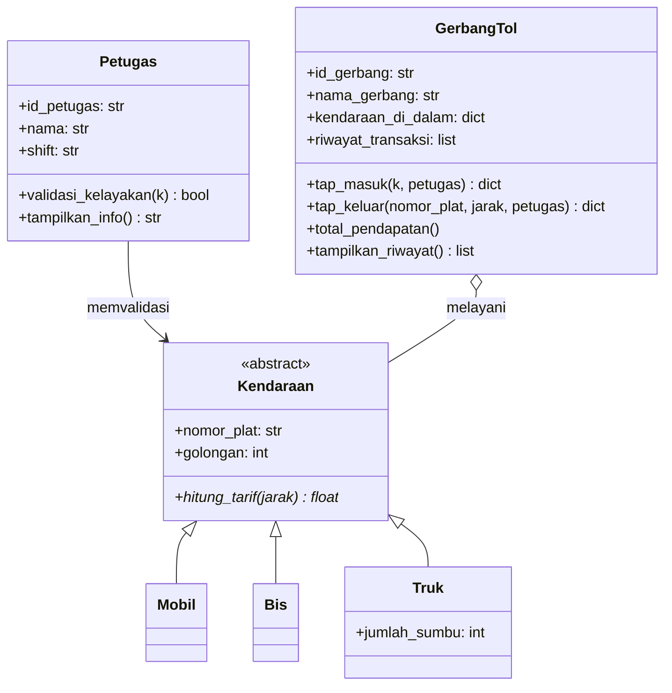

# Sistem Manajemen Tol

Mini proyek mata kuliah Pemrograman Berorientasi Objek.
Program ini mensimulasikan gerbang tol sederhana: kendaraan tap masuk, lalu tap keluar dan bayar sesuai jarak dan golongannya. Semua transaksi dicatat oleh gerbang.

## Pembagian Tugas
| Anggota | Bagian |
| --- | --- |
| Orang 1 | `kendaraan.py`, `kendaraan_khusus.py`, `test_kendaraan.py` |
| Orang 2 | `petugas.py`, `gerbang_tol.py`, `test_petugas.py`, `test_gerbang_tol.py` |
| Orang 3 | `models/__init__.py`, `main.py`, `demo_simulasi.py`, README, requirements |

## Diagram Class


## Konsep OOP yang Dipakai
- **Abstract class**: `Kendaraan` pakai `ABC` dan `@abstractmethod`, jadi tidak bisa dibuat objeknya langsung.
- **Inheritance**: `Mobil`, `Bis`, dan `Truk` turunan dari `Kendaraan`.
- **Polymorphism**: tiap subclass punya rumus `hitung_tarif()` sendiri, dan `GerbangTol` cukup memanggil `hitung_tarif()` tanpa perlu tahu jenis kendaraannya.
- **Aggregation**: `GerbangTol` menyimpan kendaraan yang sedang di dalam tol, tapi kendaraan tetap bisa ada tanpa gerbang.
- **Association**: `Petugas` memvalidasi kendaraan sebelum boleh masuk.

## Rumus Tarif
| Kendaraan | Golongan | Rumus |
| --- | --- | --- |
| Mobil | 1 | 5.000 + (jarak × 1.000) |
| Bis | 2 | 8.000 + (jarak × 1.500) |
| Truk | 3 | 12.000 + (jarak × 2.000 × jumlah sumbu) |

## Struktur Folder
```text
Tugas-Mini-Proyek-OOP/
├── main.py              # program CLI interaktif
├── demo_simulasi.py     # demo otomatis tanpa input
├── requirements.txt
├── README.md
├── models/
│   ├── __init__.py
│   ├── kendaraan.py
│   ├── kendaraan_khusus.py
│   ├── petugas.py
│   └── gerbang_tol.py
└── tests/
    ├── test_kendaraan.py
    ├── test_petugas.py
    └── test_gerbang_tol.py
```

## Cara Menjalankan
Tidak perlu install library apa pun, cukup punya Python 3.8 ke atas.

```bash
git clone https://github.com/ShionVonEverblack/Tugas-Mini-Proyek-OOP.git
cd Tugas-Mini-Proyek-OOP
```

Program interaktif:
```bash
python main.py
```
Isi data petugas dan shift, lalu pilih menu: tap masuk, tap keluar & bayar, cek pendapatan, atau lihat histori.

Demo otomatis:
```bash
python demo_simulasi.py
```

Unit test:
```bash
python -m unittest discover -s tests
```
Semua perintah dijalankan dari folder utama proyek.